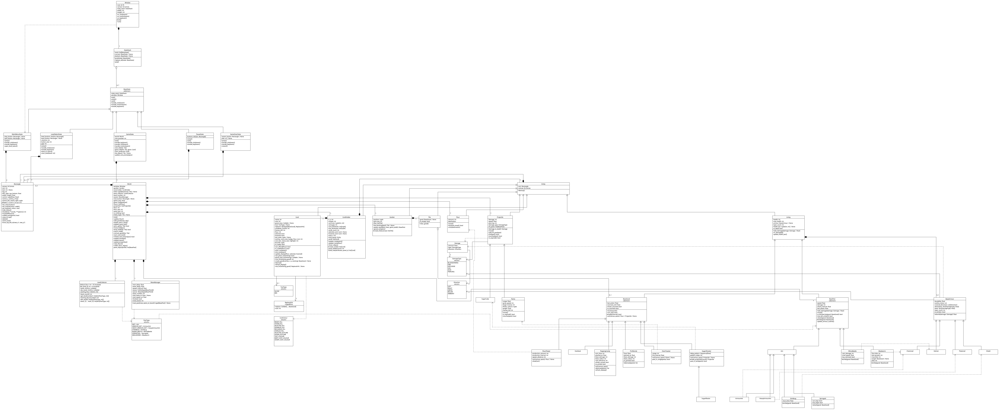

# Bakery vs Pests

This is a lane-defence game written in Python in plain tkinter, heavily inspired by "Plants vs. Zombies". You plant bakery goods on a grid, pests crawl in from the right, and your pastries try to stop them. If a single pest makes it to the left edge of the screen, it's game over.

I kind of spiralled into an armour system with damage types, attack directions and piercing values, so it's a bit more complicated than required, but I believe it is all well-designed. Sorry in advance.


Run with:
```bash
python main.py
```

`main.py` will run the pytest suite first and only opens the game passes all tests.

---

## What the game can do

### The basics
- **Menus and states**: main menu -> level select -> game. These are stored in a `StateStack`. I made a custom stack (`app/states/`) to handle pausing the state below when a new one is pushed, allowing for the game to be paused using `esc`.
- **7 levels** plus a dev level with a stupid amount of starting flour for testing. Levels are lists of waves (`levels/level_collector.py`), and `WaveManager` feeds pests in over time.
- **Flour is the currency.** Flour Flowers drop a little pile of flour every 12 seconds. You hover over it to collect it, and it floats up to the flour counter.
- **Cards** along the top show the cost, a cooldown overlay that shrinks as it recharges, and hover and selected states. They grey out when you can't afford them.
- **Upgrades**: you can drop a Sugar Shooter card onto an existing Sugar Shooter and it becomes a `Sugar Blaster`, but it's even more expensive.
- **Tools**: the `Glove` picks up a good and moves it, and the `Bin` throws one away if need be.
- **Health bars** pop up above anything once it's been hurt, going green → yellow → red. Armoured pests get a coloured outline that disappears when their armour breaks, so you can see at a glance who's still tanky.

### The bakery goods (defending the left side of the screen)

| Good | Cost | What it does |
|---|---|---|
| Flour Flower | 50 | Makes 25 flour every 12s. The only one with actual art (more on that later). |
| Sugar Shooter | 100 | Fires sugar cubes down its lane, but only when there's a pest in that lane. |
| Sugar Blaster | +200 | Upgraded shooter: fires two cubes 0.25s apart every 1.4s. |
| Hardtack | 50 | A 5000 HP brick. Does nothing. Is very good at doing nothing. |
| Popping Candy | 25 | Buried for 13s while it arms, then blows up the first pest that steps on it (and anything near it in that row). |
| Profiterole | 150 | 1.2s fuse, then explodes and hits everything in the 3x3 around it. |
| Oven Toaster | 125 | Breathes a flame 3 tiles long that burns everything it touches. Holds fire until a pest is in range. |

### The pests (attacking from the right to left)

| Pest | Gimmick |
|---|---|
| Ant | The baseline. 160 HP, slow, chews whatever's in front of it. |
| Armour Ant | Ant wearing chainmail. |
| Heavy Armour Ant | Ant wearing platemail. |
| Mealworm | Wears chainmail. Each bite on the **same** good hits harder: 40 → 65 → 90 … up to 200. If you swap the good out, the ramp resets. |
| Rhino Beetle | Charges in fast, headbutts the first good for 450, then gets tired and slows right down. Has a helmet and a thick shell. |
| Springtail | Faster, squishier ant that **jumps over** the first good it meets. |
| Stinkbug | Carries a shield. Every hit **stuns** the good for 3s (purple outline) so it can't shoot or produce. |

---

## How projectiles work

All projectiles live in `entities/projectiles/` and inherit from `Projectile`. Every frame, `World.update_projectiles()` (`app/world.py`) does this:

1. Move the projectile right by its `speed`.
2. Find every pest it's touching.
3. For each one: deal damage, remember the pest, and knock some **piercing** off the projectile, think of this kinda like its inertia.
4. Delete the projectile if it's out of piercing, expired, or off the screen.

A few details I'm weirdly proud of:

- **Hit detection uses the projectile's centre-right point.** A sugar cube "hits" when its front edge pokes into a pest. That's because they spawn from the shooter's centre-right too, so it all lines up nicely.
- **`hits()` and `touches()` are split up on purpose.** `hits()` checks "have I already hit this pest?" and then asks `touches()` about the actual collision. That means a subclass can override *only* the geometry. The **Flame** does exactly that: its whole body counts as touching, not just the tip.
- **Each projectile keeps a list of pests it's already hit**, so it can't hit the same one twice.
- **`is_expired()`** lets things have a lifetime. Sugar cubes never expire. Flames do.

The two projectiles right now:

- **Sugar Cube**: 22 damage, 6 px/frame, piercing 2. Bludgeoning damage.
- **Flame**: doesn't move at all. Instead, it grows, 9 px/frame until it reaches its full range, stays there for 20 frames flickering between orange and amber, then goes out. 20 fire damage, and its piercing is `10 ** 9`, aka "just hit everything".

## How piercing works

Every projectile has a `piercing` number, and every living thing has a `layer_count`, which returns the total layer count.

```
projectile.piercing -= pest.layer_count
```

and once piercing hits 0 or below, the projectile is done.

A pest's layer count is **its own layers + its armour's layers**, but **broken armour adds nothing**. So:

| Target | Layers |
|---|---|
| Plain ant | 1 |
| Ant in chainmail | 1 + 1 = 2 |
| Ant in platemail | 1 + 2 = 3 |
| Stinkbug (shield) | 1 + 2 = 3 |
| Rhino Beetle (thick shell + helmet) | 2 + 1 = 3 |

So a sugar cube (piercing 2) goes *through* a plain ant and can hit the one behind it. But it gets *stopped* by anything wearing heavy gear. Once you break a pest's armour, your shots start punching through again. I really like that this makes armour matter in two ways: it soaks damage and it protects whatever is standing behind it.

## Damage types and directions

Damage isn't just a number. It's a little `Damage` object holding three things:

- **amount**: can't be negative (it raises an error and is handled)
- **type**: `BLUDGEONING`, `FIRE`, `EXPLOSIVE`, `GAS`, `ACID`, `PIERCING`
- **direction**: `LEFT`, `RIGHT`, `ABOVE`, `BELOW`, `AMBIENT`

Projectiles always fly right, so they always hit pests from the LEFT. Explosions (Popping Candy, Profiterole) are AMBIENT: they come from everywhere at once. Gas and acid don't have anything using them yet, but the armour already knows how to handle them, so they're there if I add more goods.

## How armour works

Armour (`armour/base_armour.py`) has its own **durability**, separate from the pest's health. Each piece of armour is set up with four things:

- **`covered_directions`**: which sides it protects. Damage from any other direction goes straight to the pest.
- **`absorption`**: what fraction of each damage type it blocks. 1.0 means it blocks everything, 0.0 means it blocks nothing. Anything not listed defaults to 1.0.
- **`wear`**: how much durability it loses per point of damage it handles. Above 1 is a weakness (acid eats metal), below 1 is a strength.
- **`layer_count`**: extra layers for the piercing maths above.

| Armour | Durability | Covers | Notable |
|---|---|---|---|
| Chainmail | 350 | All sides | Blocks half of explosions, a quarter of piercing, zero fire/gas. Piercing and acid chew through it. |
| Platemail | 450 | All sides | Blocks ¾ of explosions and piercing, barely any fire. 2 layers. Acid still wrecks it. |
| Helmet | 250 | ABOVE only | Useless against a sugar cube from the front! |
| Shield | 500 | LEFT only | Great against projectiles from the front, but ambient blasts just go around it. 2 layers. |

Because direction is checked first, a Stinkbug's shield eats sugar cubes all day long, but a Profiterole going off next to it ignores the shield entirely. Same for the Rhino Beetle's helmet: it's only for hits from above.

### A fun bit: armour that breaks mid-hit

What happens if a hit is bigger than the armour's remaining durability? I ended up with two rules:

- **Full block** (absorption 1.0, e.g. a shield vs a sugar cube): the armour takes the *entire* hit, even if that breaks it. A shield with 100 durability that takes 250 damage -> the shield shatters and the pest takes 0. This means, shields have a big advantage, if a good is a slow but does loads of damage, a shield will always block it.
- **Partial block** (absorption < 1.0, e.g. chainmail vs an explosion): the armour only protects while it lasts, and the leftover passes through. 100-durability chainmail hit by a 250 explosion -> the first 100 gets halved, the chainmail breaks, and the other 150 hits the pest at full strength. So the pest takes 200.

One fun result: sugar cubes are bludgeoning, which chainmail **fully** blocks. So an Armour Ant takes zero damage from cubes until its chainmail is gone.

---

## The Rectangle class (essential thing this was)

tkinter's canvas is kinda annoying to work with. I call `create_rectangle(x1, y1, x2, y2)` and it stores 4 numbers representing the top-left coordinate (x1, y1) and the bottom-right coordinate (x2, y2). That's all. If I need the centre? I have to do maths. Want to move it so its right edge is at 400? Do maths.

So `app/rectangle.py` collates all of that:

- **Position properties with getters and setters**: `left`, `right`, `top`, `bottom`, `width`, `height`, `centre`, `centre_left`, `centre_right`, plus short aliases (`l`, `r`, `t`, `b`, `w`, `h`, `c`, `cx`, `cy`, `cr`, `cl`). Setting `rect.right = 400` just moves it there.
- **`collide_point()`** for clicks and hits.
- **`set_text()`** for a centred label.
- **A shared canvas tag.** Every rect gets a tag like `group42`, and the label plus any extra shape drawn with `rect.draw("oval", ...)` shares that tag. So `move`, `raise_to_top` and `delete` act on all the shapes too. Health bars are drawn this way too, so they follow pests around withour more code.
- **`hide_hitbox()`** makes the rect itself invisible but keeps it as the hitbox, for things drawn with shapes like the flour flower.

Every `Entity` its own `Rectangle` composition, so all the game logic just says things like "spawn pests at the centre-left of the lane", "fire from the shooter's centre-right", and "a pest is blocked when its left edge hits a good". The Springtail's jump is literally `self.rect.right = good.rect.left - 1`. Without this class, every one of thses would have been a load of coordinate maths.

## The Flour Flower art (and why nothing else has any)

I decided the Flour Flower should actually look like a flower. So it hides its hitbox and draws itself out of canvas shapes: a stem, two leaves, 8 petals placed around a circle with sin/cos, a yellow wheat centre, and two tiny dot eyes so it looks friendly. I had a lot of fun doing it.

It looks great. It also took **way, way too long**, nudging every coordinate by a pixel and rerunning took forever. Everything else is a labelled coloured box, and honestly, I think the flower looks bonita next to them.

The upside is in order to support it, I made `Rectangle` support tagged shapes, so if I do want to draw the rest, its already set up.

---

## The UML



I made this on umletino.com, and it took forever and isn't very pretty, but it's as good as it gets at this point. Things worth looking at:

- **Top of the diagram: `Window` -> `StateStack` -> `BaseState`.** All the screens (menu, level select, game, pause, game over) are subclasses of `BaseState`. The window just forwards clicks, mouse movement, keys and ticks to whatever state is on top.
- **`World` is central.** `GameState` owns a `World`, and the `World` owns the `Garden` (grid of `Tile`s), the `CardHolder` (`Card`s), the `WaveManager`, the `LevelCollector`, and the lists of pests, projectiles and flour. Basically all the per-frame game logic is in `World.tick()`.
- **The `Entity` tree.** Everything on screen is an `Entity`. `Living` adds health, and it splits into `BaseGood` and `BasePest`. `Projectile`, `Flour`, `Tile`, `Card`, `Garden` and `CardHolder` are entities too.
- **Every `Entity` *has a* `Rectangle`** (composition).
- **`Living` has an optional `BaseArmour`** rather than having armoured pest subclasses do their own maths. Any pest can wear any armour: `ArmourAnt` is literally just `Ant(armour=Chainmail())`.
- **`Damage`, `DamageType` and `Direction`** are value objects and enums.
- **`PestType`** is an enum that maps level data (`{PestType.ANT: 3}`) to the actual pest classes, so levels are just data.
- **Protected `_strike()` / `_ready()` / `_make_projectile()` hooks** let subclasses change behaviour (Mealworm's ramping bites, Rhino's ram, Stinkbug's stun, Blaster's projectiles) without copying the rest.

---

I hope you like my game